<p align="center">
  <picture><source media="(prefers-color-scheme: dark)" srcset="assets/header-dark.svg">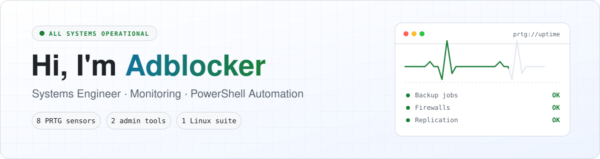</picture>
</p>

<p align="center">
  <a href="https://github.com/adblocker-1?tab=repositories"></a>
  <a href="https://github.com/adblocker-1?tab=followers"></a>
  
</p>

## 🧭 About me

```powershell
PS> Get-Adblocker | Format-List

Role       : Systems engineer in IT infrastructure
Focus      : Monitoring, backup, security, Microsoft 365
Superpower : Turning any REST API into a PRTG sensor
Toolbox    : PowerShell, Python, Bash
AfterHours : Making hardware work on Linux that was never built for it
Motto      : "If it isn't monitored, it isn't in production."
OpenTo     : Issues, ideas and pull requests on any of my projects
```

## 📡 PRTG sensor collection

Ready-to-use custom sensors for [Paessler PRTG](https://www.paessler.com/prtg). They're written in PowerShell, return clean channels and come with sensible limits.

<p align="center">
  <a href="https://github.com/adblocker-1/Veeam-backup-PRTG"><picture><source media="(prefers-color-scheme: dark)" srcset="assets/card-veeam-backup-prtg-dark.svg">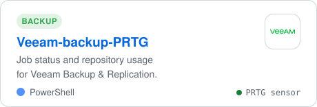</picture></a>
  <a href="https://github.com/adblocker-1/Veeam-Backup365-PRTG"><picture><source media="(prefers-color-scheme: dark)" srcset="assets/card-veeam-backup365-prtg-dark.svg">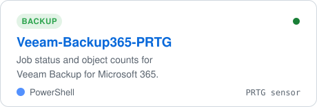</picture></a>
  <a href="https://github.com/adblocker-1/Cove-Data-Protection-PRTG"><picture><source media="(prefers-color-scheme: dark)" srcset="assets/card-cove-data-protection-prtg-dark.svg">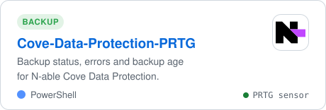</picture></a>
  <a href="https://github.com/adblocker-1/MailStore-PRTG"><picture><source media="(prefers-color-scheme: dark)" srcset="assets/card-mailstore-prtg-dark.svg">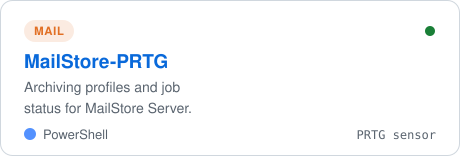</picture></a>
  <a href="https://github.com/adblocker-1/Sophos-Central-PRTG"><picture><source media="(prefers-color-scheme: dark)" srcset="assets/card-sophos-central-prtg-dark.svg">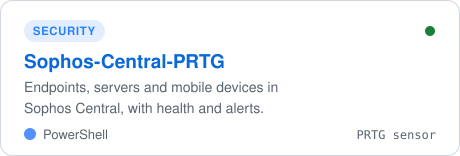</picture></a>
  <a href="https://github.com/adblocker-1/entra-Health-Check-PRTG"><picture><source media="(prefers-color-scheme: dark)" srcset="assets/card-entra-health-check-prtg-dark.svg">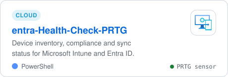</picture></a>
  <a href="https://github.com/adblocker-1/HyperVReplicaHealth-PRTG"><picture><source media="(prefers-color-scheme: dark)" srcset="assets/card-hypervreplicahealth-prtg-dark.svg">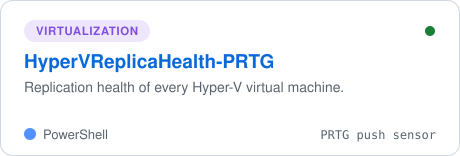</picture></a>
  <a href="https://github.com/adblocker-1/UnifiController-PRTG"><picture><source media="(prefers-color-scheme: dark)" srcset="assets/card-unificontroller-prtg-dark.svg">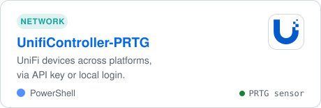</picture></a>
</p>

## 🧰 Admin tools

<p align="center">
  <a href="https://github.com/adblocker-1/Sophos-api-device-migration"><picture><source media="(prefers-color-scheme: dark)" srcset="assets/card-sophos-api-device-migration-dark.svg">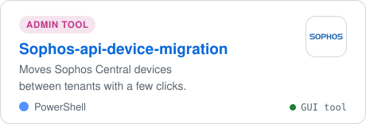</picture></a>
  <a href="https://github.com/adblocker-1/Sophos-Firewall-API-Documentation"><picture><source media="(prefers-color-scheme: dark)" srcset="assets/card-sophos-firewall-api-documentation-dark.svg">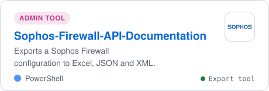</picture></a>
</p>

## 🎛️ Side project

<p align="center">
  <a href="https://github.com/adblocker-1/FreeStream"><picture><source media="(prefers-color-scheme: dark)" srcset="assets/freestream-dark.svg"></picture></a>
</p>

## 🧪 Tech I work with

<p align="center">
  
  
  
  
  <br>
  
  
  
  
  
  <br>
  
  
  
  
</p>

## 🐍 Contribution snake

<p align="center">
  <picture>
    <source media="(prefers-color-scheme: dark)" srcset="https://raw.githubusercontent.com/adblocker-1/adblocker-1/output/github-snake-dark.svg">
    
  </picture>
</p>

<p align="center">
  <sub>⭐ If one of my tools saved you time, a star is the best thank-you.</sub>
</p>
